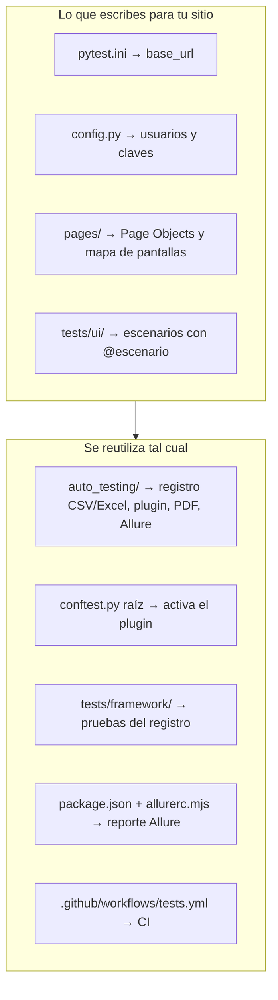

# Cómo usar este proyecto con otra página web

> **Estructura actual (monorepo):** el framework está en
> `libs/auto-testing-core/src/auto_testing/` y cada aplicación es un proyecto en
> `proyectos/<proyecto>/` con sus propios `tests/`, `pages/`, `pytest.ini` y
> `reportes/`. Las rutas de esta guía (`tests/ui/…`, `reportes/…`, `pages/…`) son
> relativas a la carpeta del proyecto, y los comandos se ejecutan desde ahí. El
> reporte Allure se genera desde la raíz con `npm run reporte:<proyecto>`. Ver
> [ARQUITECTURA.md](ARQUITECTURA.md).

Esta guía explica qué cambiar para probar **otra aplicación web** con el mismo
sistema: levantamiento incremental de escenarios en CSV/Excel, historial,
reporte PDF y reporte Allure.

> Todo lo de esta guía se probó adaptando el proyecto a
> [the-internet.herokuapp.com](https://the-internet.herokuapp.com/login), un
> sitio de práctica distinto de saucedemo y sin atributos `data-test`. El
> resultado fue de 13 escenarios exitosos, con catálogo, Excel, historial, PDF y
> Allure generados **sin modificar el framework**. Los ejemplos de código de esta
> guía son los de esa prueba.

---

## 1. Qué se reutiliza y qué se cambia

El proyecto tiene dos capas. La de abajo no depende de ningún sitio. La de
arriba es la que describe tu aplicación.



| Archivo o carpeta | ¿Qué hacer? |
|---|---|
| `auto_testing/` (registro, plugin, Excel, PDF, Allure) | **Nada.** Es genérico |
| `conftest.py` (raíz) | **Nada.** Solo activa el plugin |
| `tests/framework/` | **Nada.** Prueba el propio registro |
| `requirements.txt`, `package.json`, `.github/workflows/tests.yml` | **Nada** (salvo dependencias extra de tu proyecto) |
| `pytest.ini` | Cambiar `base_url` |
| `allurerc.mjs` | Cambiar el nombre del reporte (`name` y `reportName`) |
| `config.py` (nuevo) | Usuarios y claves de tu aplicación |
| `pages/` | **Reescribir**: Page Objects y mapa de pantallas de tu sitio |
| `tests/ui/` | **Reescribir**: los escenarios de tu sitio |
| `tests/ui/conftest.py` | **Reescribir**: fixtures de tu sitio (login, etc.) |
| `reportes/escenarios.csv` y `.xlsx` | **Borrar**: el catálogo nuevo empieza en `ESC-0001` |
| `auto_testing/comprobante_pdf.py` | Solo si tu sitio tiene compras; si no, ignóralo |
| `README.md`, `docs/` | Actualizar con tu sitio |

---

## 2. Antes de empezar

- **Permiso.** Prueba solo aplicaciones tuyas, de tu empresa o que permitan
  pruebas automatizadas (sitios de práctica). Evita producción si puedes: usa
  un ambiente de pruebas (QA o staging).
- **Datos de prueba.** Ten usuarios de prueba. **Nunca** uses tarjetas reales,
  datos personales reales ni cuentas de clientes.
- **Ambiente estable.** Cuanto más estable sea el ambiente, menos falsos
  fallos tendrás.

---

## 3. Paso a paso

### Paso 1: copia el proyecto

**Opción A (recomendada): un repositorio por sitio.**

```bash
git clone https://github.com/jdjulius/auto-testing.git mi-sitio-testing
cd mi-sitio-testing
git remote remove origin          # luego lo conectas a tu repo nuevo
```

Borra lo específico de saucedemo:

```bash
# Windows (PowerShell)
Remove-Item -Recurse tests\ui, pages
Remove-Item reportes\escenarios.csv, reportes\escenarios.xlsx

# Mac / Linux
rm -rf tests/ui pages reportes/escenarios.csv reportes/escenarios.xlsx
```

> Para tener **varios sitios en el mismo repositorio**, mira la
> [sección 6](#6-varios-sitios-en-el-mismo-repositorio).

### Paso 2: apunta a tu sitio

En `pytest.ini`, cambia la URL base:

```ini
[pytest]
testpaths = tests
base_url = https://mi-aplicacion.com
addopts = -ra --browser chromium --alluredir=reportes/allure-results --clean-alluredir
markers =
    escenario: documenta el escenario de prueba (lo registra el plugin auto_testing)
```

Con `base_url`, en los Page Objects se navega con rutas relativas:
`page.goto("/login")`.

En `allurerc.mjs`, cambia `"auto-testing · saucedemo"` por el nombre de tu
proyecto, en `name` y en los dos `reportName`.

### Paso 3: credenciales en `config.py`

Crea `config.py` en la raíz. **No escribas claves reales en el código**: léelas
de variables de entorno.

```python
"""Datos de la aplicación bajo prueba. Las credenciales se leen de variables de entorno."""

import os

USUARIO = os.environ.get("APP_USUARIO", "usuario_de_prueba")
CLAVE = os.environ.get("APP_CLAVE", "")
```

Para definirlas antes de ejecutar:

```powershell
# Windows (PowerShell)
$env:APP_USUARIO = "mi_usuario"
$env:APP_CLAVE   = "mi_clave"
```

```bash
# Mac / Linux
export APP_USUARIO=mi_usuario APP_CLAVE=mi_clave
```

En GitHub Actions, guárdalas como *secrets* (Settings → Secrets and variables →
Actions) y pásalas al paso de pytest:

```yaml
      - run: pytest --tracing retain-on-failure --screenshot only-on-failure
        env:
          APP_USUARIO: ${{ secrets.APP_USUARIO }}
          APP_CLAVE: ${{ secrets.APP_CLAVE }}
```

### Paso 4: releva las pantallas de tu sitio

Este es el **levantamiento**: antes de escribir pruebas, recorre el sitio y anota
cada pantalla.

1. **Lista las pantallas** con su ruta (`/login`, `/dashboard`, `/perfil`…).
2. **Para cada pantalla, lista sus componentes**: campos, botones, mensajes,
   tablas, menús.
3. **Busca un selector estable** para cada componente, en este orden de
   preferencia:

| Prioridad | Selector | Ejemplo en Playwright | Por qué |
|---|---|---|---|
| 1 | Atributo de pruebas (`data-test`, `data-testid`, `data-cy`) | `page.get_by_test_id("login-button")` | Lo ponen los desarrolladores para pruebas; casi nunca cambia |
| 2 | Rol y texto visible | `page.get_by_role("button", name="Login")` | Es como lo ve el usuario; resiste cambios de diseño |
| 3 | Etiqueta del campo | `page.get_by_label("Username")` | Ideal para formularios |
| 4 | `id` | `page.locator("#username")` | Estable si los ids no se generan solos |
| 5 | CSS o XPath por estructura | `page.locator("div > form > button")` | **Evítalo**: se rompe con cualquier cambio de diseño |

**Herramientas que ayudan:**

- **Grabador de Playwright.** Abre tu sitio, haz clic como usuario y genera el
  código con los selectores:

  ```bash
  python -m playwright codegen https://mi-aplicacion.com
  ```

- **DevTools del navegador** (F12 → Elements): para ver si tu sitio tiene
  atributos de prueba. Busca `data-test`, `data-testid` o `data-cy`.
- **Inspector de Playwright**: ejecuta una prueba paso a paso.

  ```powershell
  $env:PWDEBUG = "1"; pytest tests/ui/test_login.py
  ```

Si tu sitio usa un atributo de pruebas que **no** es `data-testid` (que es el
que Playwright usa por defecto), configúralo en `tests/ui/conftest.py`. Por
ejemplo, saucedemo usa `data-test`:

```python
@pytest.fixture(scope="session", autouse=True)
def _atributo_test_id(playwright):
    playwright.selectors.set_test_id_attribute("data-test")   # o "data-cy", etc.
```

### Paso 5: escribe el mapa de pantallas

En `pages/mapa.py`, registra lo que relevaste. Así queda una prueba automática
por pantalla, que avisa si desaparece algún componente.

```python
"""Mapa de pantallas: ruta, título y componentes de cada pantalla."""

from dataclasses import dataclass, field


@dataclass(frozen=True)
class Pantalla:
    clave: str
    nombre: str
    ruta: str
    # nombre legible -> selector CSS
    componentes: dict[str, str] = field(default_factory=dict)


PANTALLAS = [
    Pantalla("login", "Login", "/login", {
        "Usuario": "#username",
        "Contraseña": "#password",
        "Botón Login": "button[type=submit]",
    }),
    Pantalla("zona-segura", "Zona segura", "/secure", {
        "Título": "h2",
        "Mensaje": "#flash",
        "Logout": "a[href='/logout']",
    }),
]
```

> Saucedemo guarda valores de `data-test` en el mapa y los busca con
> `get_by_test_id`. Si tu sitio no tiene atributos de prueba, guarda selectores
> CSS como en el ejemplo y búscalos con `page.locator(selector)`.

### Paso 6: crea los Page Objects

Un archivo por pantalla en `pages/`. Cada uno guarda los selectores de la
pantalla y las acciones que se hacen en ella. Si un selector cambia, se corrige
en un solo lugar.

`pages/login.py`:

```python
import allure
from playwright.sync_api import Page


class LoginPage:
    URL = "/login"

    def __init__(self, page: Page) -> None:
        self.page = page
        self.usuario = page.get_by_label("Username")
        self.clave = page.get_by_label("Password")
        self.boton = page.get_by_role("button", name="Login")
        self.mensaje = page.locator("#flash")

    @allure.step("Abrir la página de login")
    def abrir(self) -> "LoginPage":
        self.page.goto(self.URL)
        return self

    @allure.step("Iniciar sesión como '{usuario}'")
    def ingresar(self, usuario: str, clave: str) -> None:
        self.usuario.fill(usuario)
        self.clave.fill(clave)
        self.boton.click()
```

`pages/zona_segura.py`:

```python
import allure
from playwright.sync_api import Page


class ZonaSeguraPage:
    URL = "/secure"

    def __init__(self, page: Page) -> None:
        self.page = page
        self.titulo = page.get_by_role("heading", name="Secure Area", exact=False)
        self.mensaje = page.locator("#flash")
        self.cerrar_sesion = page.get_by_role("link", name="Logout")

    @allure.step("Cerrar sesión")
    def salir(self) -> None:
        self.cerrar_sesion.click()
```

`pages/__init__.py`:

```python
from pages.login import LoginPage
from pages.zona_segura import ZonaSeguraPage

__all__ = ["LoginPage", "ZonaSeguraPage"]
```

> El decorador `@allure.step(...)` hace que cada acción aparezca como un
> **paso** en el reporte Allure. `{usuario}` se reemplaza por el valor real.
> **No pongas la contraseña** en el texto de un paso.

### Paso 7: fixtures en `tests/ui/conftest.py`

Los *fixtures* preparan el estado para cada prueba, por ejemplo "sesión ya
iniciada":

```python
import pytest
from playwright.sync_api import Page

from config import CLAVE, USUARIO
from pages import LoginPage, ZonaSeguraPage


@pytest.fixture
def login(page: Page) -> LoginPage:
    return LoginPage(page).abrir()


@pytest.fixture
def zona_segura(login: LoginPage) -> ZonaSeguraPage:
    """Sesión iniciada, en la zona segura."""
    login.ingresar(USUARIO, CLAVE)
    return ZonaSeguraPage(login.page)
```

### Paso 8: escribe los escenarios

Cada prueba con su marcador `@pytest.mark.escenario`. El plugin la registra sola
en el catálogo. `tests/ui/test_login.py`:

```python
import re

import pytest
from playwright.sync_api import expect

from config import CLAVE, USUARIO
from pages import LoginPage, ZonaSeguraPage


@pytest.mark.escenario(
    modulo="Login",
    funcionalidad="Inicio de sesión",
    descripcion="Iniciar sesión con credenciales válidas",
    resultado_esperado="Redirige a /secure y muestra 'You logged into a secure area!'",
    prioridad="Crítica",
)
def test_login_exitoso(login: LoginPage):
    login.ingresar(USUARIO, CLAVE)
    expect(login.page).to_have_url(re.compile(r"/secure$"))
    expect(ZonaSeguraPage(login.page).mensaje).to_contain_text("You logged into a secure area!")


@pytest.mark.escenario(
    modulo="Login",
    funcionalidad="Validación de credenciales",
    descripcion="Rechazar credenciales inválidas",
    resultado_esperado="Permanece en /login con el mensaje de error",
    prioridad="Alta",
)
@pytest.mark.parametrize(
    "usuario, clave, mensaje",
    [("otro", CLAVE, "Your username is invalid!"), (USUARIO, "mala", "Your password is invalid!")],
    ids=["usuario-invalido", "clave-invalida"],
)
def test_login_fallido(login: LoginPage, usuario, clave, mensaje):
    login.ingresar(usuario, clave)
    expect(login.mensaje).to_contain_text(mensaje)
    expect(login.page).to_have_url(re.compile(r"/login$"))
```

Y la prueba del mapa de pantallas, `tests/ui/test_pantallas.py`:

```python
import re

import pytest
from playwright.sync_api import Page, expect

from config import CLAVE, USUARIO
from pages import LoginPage
from pages.mapa import PANTALLAS, Pantalla


def _llegar(page: Page, clave: str) -> None:
    """Lleva el navegador al estado en que se ve cada pantalla."""
    login = LoginPage(page).abrir()
    if clave == "zona-segura":
        login.ingresar(USUARIO, CLAVE)


@pytest.mark.escenario(
    modulo="Pantallas",
    funcionalidad="Mapa de pantallas",
    descripcion="La pantalla muestra todos sus componentes",
    resultado_esperado="Ruta correcta y cada componente del mapa visible",
)
@pytest.mark.parametrize("pantalla", PANTALLAS, ids=[p.clave for p in PANTALLAS])
def test_pantalla(page: Page, pantalla: Pantalla):
    _llegar(page, pantalla.clave)
    expect(page).to_have_url(re.compile(re.escape(pantalla.ruta) + r"$"))
    faltantes = []
    for nombre, selector in pantalla.componentes.items():
        try:
            expect(page.locator(selector).first).to_be_visible(timeout=3_000)
        except AssertionError:
            faltantes.append(f"{nombre} [{selector}]")
    assert not faltantes, f"Faltan en {pantalla.nombre}: {', '.join(faltantes)}"
```

### Paso 9: levanta y ejecuta

```bash
pytest --collect-only -q      # 1) levanta los escenarios sin ejecutarlos
pytest                        # 2) ejecuta y registra resultados
npm run reporte:<proyecto>    # 3) genera el reporte Allure (desde la raíz)
```

Con el ejemplo, el primer paso muestra:

```
auto-testing: escenarios
Catálogo: reportes/escenarios.csv (13 escenarios, 13 nuevos)
  + ESC-0001  Asignar IDs consecutivos y no duplicar escenarios
  ...
  + ESC-0007  Iniciar sesión con credenciales válidas
  + ESC-0008  Rechazar credenciales inválidas [usuario-invalido]
  + ESC-0009  Rechazar credenciales inválidas [clave-invalida]
  ...
```

Los primeros 6 son las pruebas del framework (`tests/framework/`). Si no las
quieres en el catálogo de tu sitio, ejecuta solo tus pruebas: `pytest tests/ui`.

Se generan los mismos archivos que con saucedemo:

| Archivo | Contenido |
|---|---|
| `reportes/escenarios.csv` y `.xlsx` | Catálogo de escenarios con su último estado |
| `reportes/ejecuciones.csv` | Historial de cada corrida |
| `reportes/reporte.pdf` | Reporte PDF de la corrida |
| `reportes/allure-report/` | Reporte Allure (después de `npm run reporte:<proyecto>`) |

Haz commit de `reportes/escenarios.csv` y `reportes/escenarios.xlsx` junto con
las pruebas.

---

## 4. Qué escenarios levantar (lista de verificación)

Usa esta lista para no olvidar áreas. No todas aplican a todos los sitios.

**Por pantalla**
- [ ] La pantalla carga en su ruta y muestra todos sus componentes (mapa de pantallas)
- [ ] Título y textos principales correctos

**Login y sesión**
- [ ] Login válido
- [ ] Credenciales inválidas, campos vacíos, usuario bloqueado
- [ ] Mayúsculas y espacios en el usuario
- [ ] Login con Enter
- [ ] La contraseña se oculta
- [ ] Logout, y volver atrás tras el logout
- [ ] Páginas protegidas sin sesión redirigen al login
- [ ] Intentos de inyección (SQL/XSS) se rechazan sin ejecutarse

**Formularios**
- [ ] Campos obligatorios (uno por uno)
- [ ] Formatos inválidos (correo, teléfono, fechas)
- [ ] Datos solo con espacios
- [ ] Acentos, ñ, apóstrofos y guiones
- [ ] Longitudes máximas
- [ ] El formulario conserva lo escrito

**Flujos de negocio**
- [ ] El flujo principal de punta a punta (compra, registro, solicitud…)
- [ ] Cálculos: subtotales, impuestos, descuentos, totales
- [ ] Reglas de negocio: qué **no** se debe permitir (por ejemplo, comprar con el carrito vacío)
- [ ] Cancelar en cada paso y a dónde vuelve

**Navegación y redirecciones**
- [ ] Cada enlace y botón lleva a donde debe
- [ ] Menús
- [ ] Enlaces externos (abren en pestaña nueva, URL correcta)
- [ ] Rutas inexistentes (página 404 o mensaje adecuado)

**Calidad**
- [ ] Sin errores de JavaScript (`page.on("pageerror", ...)`)
- [ ] Imágenes que cargan y tienen texto alternativo
- [ ] Móvil, tablet y escritorio sin desplazamiento horizontal
- [ ] Tiempo de carga razonable

**Variantes**
- [ ] Cada tipo de usuario o rol (admin, cliente, invitado…)
- [ ] Datos diferentes con `@pytest.mark.parametrize`

> **Explora el sitio en vivo** antes de dar por cerrado el levantamiento: usa el
> grabador o un script de Playwright para revisar cookies, mensajes, códigos HTTP y
> validaciones. Así aparecieron en saucedemo defectos que no eran evidentes a
> simple vista: acceso con una cookie forjada, compras con el carrito vacío o datos
> en blanco aceptados.

---

## 5. Defectos conocidos

Si un escenario encuentra un **defecto real** que no se va a corregir pronto,
no lo borres ni lo ignores. Márcalo como defecto conocido:

```python
@pytest.mark.escenario(
    modulo="Checkout",
    funcionalidad="Reglas de negocio",
    descripcion="No se puede comprar con el carrito vacío",
    resultado_esperado="El checkout con el carrito vacío se bloquea",
    prioridad="Alta",
)
@pytest.mark.xfail(strict=True, reason="El sitio permite completar una compra sin productos")
def test_checkout_carrito_vacio(...):
    ...
```

- Queda en el catálogo como `XFAIL`, con el motivo en el historial, y no rompe la corrida.
- Con `strict=True`, **si el defecto se corrige la prueba falla** y te avisa que
  hay que quitar el `xfail`.
- La prueba se escribe con el **comportamiento correcto** como expectativa,
  nunca con el comportamiento defectuoso.

---

## 6. Varios sitios en el mismo repositorio

Si prefieres no copiar el proyecto, separa cada sitio en su carpeta y dale su
propio catálogo:

```
pages/
  saucedemo/        Page Objects de saucedemo
  mi_sitio/         Page Objects de tu sitio
tests/
  saucedemo/        pruebas de saucedemo
  mi_sitio/         pruebas de tu sitio
reportes/
  saucedemo/        catálogo, historial y PDF de saucedemo
  mi_sitio/         catálogo, historial y PDF de tu sitio
```

Ejecuta cada sitio indicando su URL y sus archivos. Las opciones de la línea de
comandos reemplazan a las de `pytest.ini`:

```bash
pytest tests/mi_sitio \
  --base-url https://mi-aplicacion.com \
  --escenarios-csv reportes/mi_sitio/escenarios.csv \
  --ejecuciones-csv reportes/mi_sitio/ejecuciones.csv \
  --reporte-pdf reportes/mi_sitio/reporte.pdf \
  --alluredir reportes/mi_sitio/allure-results
```

En PowerShell, reemplaza `\` por `` ` `` al final de cada línea, o escribe todo
en una sola línea.

El Excel se genera junto al CSV (`reportes/mi_sitio/escenarios.xlsx`). Cada
catálogo tiene su propia numeración desde `ESC-0001`.

---

## 7. Problemas comunes

| Problema | Causa probable | Solución |
|---|---|---|
| `Timeout ... waiting for locator` | El selector no existe o la pantalla tarda | Verifica el selector con `python -m playwright codegen`; espera un componente propio de la pantalla antes de leerla |
| `strict mode violation: resolved to N elements` | El selector encuentra varios elementos | Hazlo más específico, o usa `.first` / `.nth(i)` si es lo que quieres |
| La prueba pasa a veces y a veces falla | Se leyó la pantalla antes de que terminara de dibujarse (la URL cambia antes que el contenido en apps SPA) | Espera un componente propio de la pantalla nueva con `expect(...).to_be_visible()` antes de leer datos |
| `Executable doesn't exist` al iniciar | Falta el navegador de Playwright | `python -m playwright install chromium`, o usa tu Chrome con `pytest --browser-channel chrome` |
| La descarga del navegador da timeout | Red lenta o proxy | `$env:PLAYWRIGHT_DOWNLOAD_CONNECTION_TIMEOUT = "600000"` y reintenta, o usa `--browser-channel chrome` |
| `ID de escenario duplicado` | Dos pruebas con el mismo `id="..."` en el marcador | Cambia uno de los dos o quita el `id` y deja el autoincremental |
| Excel no separa las columnas del CSV | Excel en español separa por `;` | Abre `reportes/escenarios.xlsx` |
| El sitio pide captcha o doble factor | Protección contra bots | Pide un usuario de prueba sin captcha/2FA en el ambiente de QA |

---

## 8. Resumen

1. Copia el proyecto y borra `tests/ui`, `pages` y el catálogo.
2. Cambia `base_url` en `pytest.ini` y el nombre en `allurerc.mjs`.
3. Pon las credenciales en `config.py`, leídas de variables de entorno.
4. Releva las pantallas: rutas, componentes y selectores estables.
5. Escribe `pages/mapa.py` y un Page Object por pantalla.
6. Escribe los fixtures y los escenarios con `@pytest.mark.escenario`.
7. `pytest --collect-only` → `pytest` → `npm run reporte:<proyecto>` (desde la raíz).
8. Marca los defectos reales con `xfail(strict=True)`.

El registro de escenarios, el historial, el Excel, el PDF y el reporte Allure
funcionan solos: **solo escribes la parte que describe tu sitio.**
