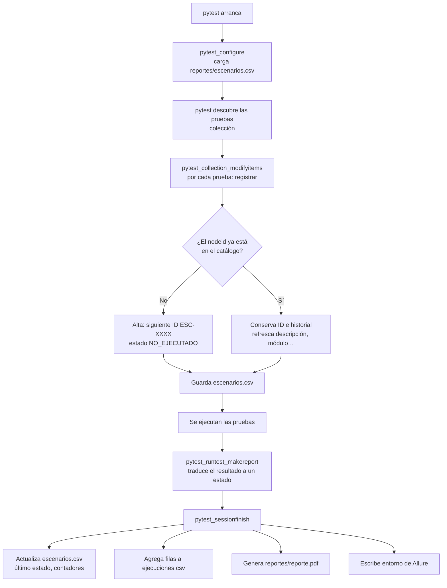

# Levantamiento y registro de escenarios de prueba

Este documento explica cómo el proyecto **descubre, documenta, numera y registra**
los escenarios de prueba, y cómo guarda sus resultados de forma incremental.

---

## 1. La idea en una frase

> **Cada prueba de pytest es un escenario.** Cada vez que corre pytest, el plugin
> `auto_testing` compara las pruebas que encuentra con el catálogo
> (`reportes/escenarios.csv`), da de alta las nuevas con el siguiente ID
> (`ESC-0001`, `ESC-0002`, …) y, al terminar, anota el resultado de cada una.

No hay que mantener el catálogo a mano: **el código de las pruebas es la fuente
de verdad** y el CSV se genera a partir de él.

---

## 2. Flujo completo de una corrida



Puntos clave:

1. **El levantamiento ocurre en la colección, antes de ejecutar.** Por eso
   `pytest --collect-only` sirve para levantar escenarios nuevos sin correr nada.
2. **El catálogo se guarda dos veces**: al terminar la colección (altas) y al
   terminar la corrida (resultados).
3. **El historial solo crece**: nunca se reescriben filas viejas de
   `ejecuciones.csv`.

El código está en dos archivos:

| Archivo | Responsabilidad |
|---|---|
| `auto_testing/plugin.py` | Hooks de pytest: lee el marcador, decide los estados y dispara el guardado, el PDF y Allure |
| `auto_testing/registro.py` | Clase `RegistroEscenarios`: lee y escribe los CSV, asigna IDs y lleva los contadores |

---

## 3. Cómo se documenta un escenario

### 3.1 Con el marcador `@pytest.mark.escenario` (recomendado)

```python
@pytest.mark.escenario(
    modulo="Checkout paso 2",            # agrupación principal
    funcionalidad="Resumen Overview",    # subgrupo
    descripcion="Validar subtotal, impuesto (8%) y total",
    resultado_esperado="Subtotal = suma de precios; impuesto = 8%; total = subtotal + impuesto",
    prioridad="Crítica",                 # Crítica | Alta | Media (default) | Baja
    # id="CP-TOTALES-01",                # opcional: ID manual en vez del autoincremental
)
def test_paso2_totales(inventario, productos):
    ...
```

### 3.2 Sin marcador

El escenario se registra igual, con valores por defecto:

| Campo | Valor por defecto |
|---|---|
| `descripcion` | primera línea del docstring de la prueba o, si no tiene, el nombre de la función |
| `modulo` | nombre del archivo sin `test_` (por ejemplo, `test_login.py` queda como `login`) |
| `prioridad` | `Media` |

### 3.3 Pruebas parametrizadas: un escenario por variante

Cada combinación de `@pytest.mark.parametrize` es **un escenario distinto**, y el
ID de la variante se agrega a la descripción:

```python
@pytest.mark.parametrize("productos", CARRITOS.values(), ids=CARRITOS.keys())
```

produce, por ejemplo:

```
ESC-0081  Validar subtotal, impuesto (8%) y total [un-producto]
ESC-0082  Validar subtotal, impuesto (8%) y total [tres-productos]
ESC-0083  Validar subtotal, impuesto (8%) y total [todos]
```

pytest-playwright agrega el navegador como parámetro (`[chromium-...]`). El
plugin lo quita de la descripción y lo guarda en la columna `navegador`.

> Conviene dar `ids=` legibles a cada `parametrize`: son lo que se ve en el
> catálogo y en los reportes.

---

## 4. Cómo se asignan los IDs

- **La clave única de un escenario es su `nodeid`**, el identificador que pytest
  da a cada prueba, por ejemplo
  `tests/ui/test_login.py::test_login_fallido[chromium-usuario-bloqueado]`.
- **ID nuevo = el mayor `ESC-NNNN` existente + 1**, con cuatro dígitos.
- **Un ID nunca se reutiliza ni cambia.** Aunque cambies la descripción o el
  módulo, el escenario conserva su ID y su historial.
- **ID manual:** si el marcador trae `id="..."`, se usa ese ID. Si ya existe
  para otra prueba, la corrida se detiene con `ID de escenario duplicado`.
- Los escenarios se guardan ordenados por ID.

### Qué pasa en cada situación

| Situación | Qué hace el registro |
|---|---|
| Prueba nueva | Alta con el siguiente ID, `fecha_alta` = ahora, estado `NO_EJECUTADO` |
| Prueba existente | Mantiene ID, fecha de alta y contadores; actualiza la documentación si cambió en el marcador |
| Nueva variante de un `parametrize` | Es un `nodeid` nuevo, así que se da de alta como escenario nuevo |
| Prueba renombrada o movida de archivo | Su `nodeid` cambia: se da de alta como escenario nuevo y la fila anterior queda como histórico (ver §10 para conservar el ID) |
| Prueba eliminada | Su fila se conserva con su último estado (no se borra historial) |
| `pytest -k login` (corrida parcial) | Solo se registran y actualizan las pruebas seleccionadas; las demás no cambian |

---

## 5. Estados y cómo se calculan

Al terminar cada prueba, el plugin traduce el resultado de pytest a un estado:

| Estado | Cuándo |
|---|---|
| `EXITOSO` | La prueba pasó |
| `FALLIDO` | Falló una verificación (`assert`/`expect`) |
| `ERROR` | Falló un fixture en el setup o el teardown (problema de la prueba o del entorno) |
| `XFAIL` | **Defecto conocido** de la aplicación que se reprodujo (`@pytest.mark.xfail`) |
| `XPASS` | Se esperaba un defecto conocido (`xfail` no estricto), pero no apareció. Con `strict=True` pytest lo reporta como fallo y queda `FALLIDO` |
| `OMITIDO` | La prueba se saltó (`skip`) |
| `NO_EJECUTADO` | Se levantó pero todavía no se ha ejecutado |

Con cada resultado:

- `ultimo_estado` y `ultima_ejecucion` se sobrescriben;
- `ejecuciones` suma 1;
- `fallos` suma 1 si el estado es `FALLIDO` o `ERROR`;
- se agrega una fila a `ejecuciones.csv` con duración y mensaje: el error si
  falló, o el motivo del defecto conocido si es `XFAIL`.

### Defectos conocidos (usuarios especiales de saucedemo)

En `tests/ui/test_usuarios.py` cada funcionalidad se prueba con todos los
usuarios. Los defectos intencionales del sitio se declaran en un diccionario:

```python
DEFECTOS = {
    "ordenar": {
        "problem_user": "El ordenamiento no cambia la lista",
        "error_user": "Ordenar muestra un error y no cambia la lista",
        "visual_user": "Los precios mostrados no quedan ordenados",
    },
    ...
}
```

Esas combinaciones se marcan como `xfail(strict=True)`: quedan como `XFAIL` en
el catálogo con el motivo, y **si el defecto deja de aparecer la prueba falla**
(queda `FALLIDO`, con el mensaje `[XPASS(strict)]`) para avisar que hay que revisarla. El login lento de `performance_glitch_user`
no es estricto, porque depende de la carga del sitio.

---

## 6. Los archivos que se generan

### 6.1 `reportes/escenarios.csv`: el catálogo (versionado en git)

Una fila por escenario:

| Columna | Contenido |
|---|---|
| `id` | `ESC-0001`… |
| `nodeid` | Identificador pytest (clave única) |
| `modulo`, `funcionalidad` | Agrupación |
| `descripcion` | Qué se prueba (con la variante entre corchetes) |
| `resultado_esperado` | Criterio de aceptación |
| `prioridad` | Crítica / Alta / Media / Baja |
| `fecha_alta` | Cuándo se levantó |
| `navegador` | Navegador de las pruebas de UI |
| `ultimo_estado`, `ultima_ejecucion` | Resultado y fecha de la última vez que corrió |
| `ejecuciones`, `fallos` | Contadores acumulados |

Ejemplo de una fila después de tres corridas:

```csv
id,nodeid,modulo,funcionalidad,descripcion,resultado_esperado,prioridad,fecha_alta,navegador,ultimo_estado,ultima_ejecucion,ejecuciones,fallos
ESC-0018,tests/ui/test_login.py::test_login_exitoso[chromium],Login,Inicio de sesión,Iniciar sesión con usuario válido,Redirige a /inventory.html y muestra 'Products',Crítica,2026-10-11T04:21:53,chromium,EXITOSO,2026-10-11T05:38:40,3,0
```

El archivo se reescribe de forma **atómica**: primero en un temporal y luego se
reemplaza. Si la corrida se interrumpe, el catálogo no queda a medias.

### 6.2 `reportes/ejecuciones.csv`: el historial (solo crece)

Una fila por escenario **en cada corrida**, siempre agregada al final:

| Columna | Contenido |
|---|---|
| `run_id` | `RUN-AAAAMMDD-HHMMSS`, común a toda la corrida |
| `fecha` | Momento del resultado |
| `escenario_id`, `nodeid` | A qué escenario corresponde |
| `estado` | Estado de esa ejecución |
| `duracion_s` | Duración en segundos |
| `mensaje` | Error (si falló) o motivo del defecto conocido (si es XFAIL) |

Con este archivo se puede reconstruir la evolución de cualquier escenario:
cuándo empezó a fallar, cuánto tarda, etc.

### 6.3 Reportes derivados

| Archivo | Qué contiene |
|---|---|
| `reportes/reporte.pdf` | Resumen de la corrida, tabla por módulo, fallas que requieren atención y detalle de cada escenario |
| `reportes/compras/compra-*.pdf` | Comprobante de cada compra hecha en las pruebas |
| `reportes/allure-report/` | Reporte Allure con pasos, capturas y adjuntos (`npm run reporte`) |

Los tres toman los datos del escenario (ID, módulo, funcionalidad, prioridad,
resultado esperado) del mismo registro.

---

## 7. Cómo se levantaron los escenarios de saucedemo

El levantamiento siguió estas capas, de lo general a lo particular:

1. **Mapa de pantallas** (`pages/mapa.py`): cada pantalla con su ruta, su título
   y sus componentes (`data-test`). `tests/ui/test_pantallas.py` genera un
   escenario por pantalla que verifica que todos los componentes existan.
2. **Funcionalidades por pantalla**: login, inventario (catálogo y ordenamiento),
   carrito, checkout.
3. **Flujo de compra paso a paso**: formulario del paso 1, validación de
   productos, pago, envío y totales del paso 2, confirmación, Back Home y PDF
   de la compra.
4. **Redirecciones**: páginas protegidas sin sesión, navegación entre pantallas,
   menú lateral y enlaces externos.
5. **Variantes por usuario**: las mismas funcionalidades con los 6 usuarios del
   sitio, con sus defectos conocidos como `xfail`.
6. **Framework**: pruebas del propio registro (IDs, historial, PDF).

Resultado actual (96 escenarios):

| Módulo | Archivo | Escenarios | IDs |
|---|---|---:|---|
| Framework | `tests/framework/test_registro.py` | 4 | ESC-0001 a 0003, ESC-0056 |
| Carrito | `tests/ui/test_carrito.py` | 4 | ESC-0004 a 0007 |
| Checkout | `tests/ui/test_checkout.py` | 5 | ESC-0008 a 0012 |
| Inventario | `tests/ui/test_inventario.py` | 5 | ESC-0013 a 0017 |
| Login | `tests/ui/test_login.py` | 8 | ESC-0018 a 0025 |
| Usuarios | `tests/ui/test_usuarios.py` | 30 | ESC-0026 a 0055 |
| Redirecciones | `tests/ui/test_redirecciones.py` | 17 | ESC-0057 a 0073 |
| Checkout paso 1 | `tests/ui/test_flujo_compra.py` | 3 | ESC-0074 a 0076 |
| Checkout paso 2 | `tests/ui/test_flujo_compra.py` | 7 | ESC-0077 a 0083 |
| Checkout completo | `tests/ui/test_flujo_compra.py` | 5 | ESC-0084 a 0088 |
| Pantallas | `tests/ui/test_pantallas.py` | 8 | ESC-0089 a 0096 |

Los IDs reflejan **el orden en que se fueron levantando**, no el módulo. Por eso
el escenario del PDF del framework (ESC-0056) quedó entre los de usuarios y los
de redirecciones: se agregó en ese momento.

---

## 8. Cómo agregar escenarios nuevos

1. Escribe la prueba en `tests/ui/` (o donde corresponda) con su marcador:

   ```python
   @pytest.mark.escenario(
       modulo="Carrito",
       funcionalidad="Cantidades",
       descripcion="No permitir cantidades negativas",
       resultado_esperado="Se muestra un error y el carrito no cambia",
       prioridad="Alta",
   )
   def test_cantidad_negativa(inventario):
       ...
   ```

2. Levanta el escenario sin ejecutarlo, para ver qué ID recibe:

   ```bash
   pytest --collect-only -q
   ```

   Al final aparece el resumen:

   ```
   auto-testing: escenarios
   Catálogo: reportes/escenarios.csv (97 escenarios, 1 nuevos)
     + ESC-0097  No permitir cantidades negativas
   ```

3. Ejecuta:

   ```bash
   pytest -k cantidad_negativa      # solo el nuevo
   pytest                           # o todo
   ```

4. Haz commit de `reportes/escenarios.csv` junto con la prueba, para que el
   catálogo versionado incluya el escenario nuevo.

> Si una prueba nueva revela un defecto real de la aplicación que no se va a
> corregir pronto, márcala con `@pytest.mark.xfail(reason="...", strict=True)`.
> Así queda registrada como defecto conocido y no rompe la corrida.

---

## 9. Comandos de referencia

| Comando | Qué hace |
|---|---|
| `pytest` | Levanta, ejecuta y registra todo; genera el PDF y los resultados de Allure |
| `pytest --collect-only -q` | Solo levanta escenarios nuevos (no ejecuta) |
| `pytest -k checkout` | Ejecuta y registra solo los escenarios que coinciden |
| `pytest --sin-registro` | Ejecuta sin tocar los CSV |
| `pytest --sin-pdf` | Ejecuta sin generar el PDF |
| `pytest --escenarios-csv X --ejecuciones-csv Y` | Usa otros archivos de catálogo e historial |
| `pytest --browser-channel chrome` | Usa el Chrome instalado en vez del Chromium de Playwright |
| `python -m auto_testing.reporte_pdf` | Regenera el PDF de la última corrida desde los CSV |
| `npm run reporte` | Genera el reporte Allure en `reportes/allure-report/` |

---

## 10. Limitaciones conocidas

- **Ejecución en paralelo** (`pytest-xdist`): el registro solo corre en el
  proceso principal. Con xdist los resultados de los workers no se registran.
- **Renombrar o mover una prueba** cambia su `nodeid`: se crea un escenario
  nuevo y el anterior queda como histórico. Si quieres conservar el ID y los
  contadores, edita la columna `nodeid` de esa fila en `reportes/escenarios.csv`
  con el nombre nuevo antes de volver a ejecutar pytest.
- **Varias personas a la vez:** si dos personas corren pytest y hacen commit
  del catálogo al mismo tiempo, puede haber conflictos en
  `reportes/escenarios.csv`. Se resuelven trayendo el cambio remoto y volviendo
  a ejecutar `pytest --collect-only`.
